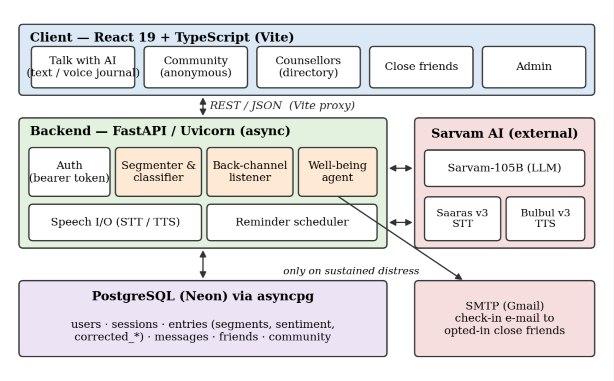
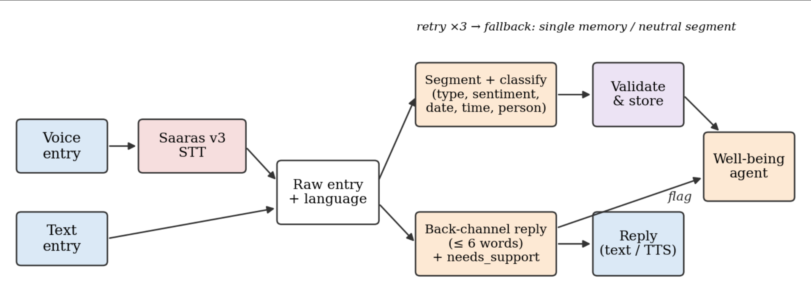
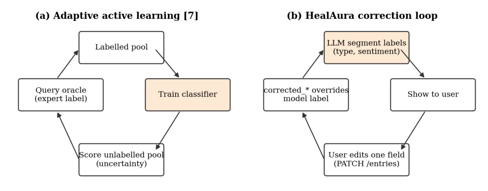
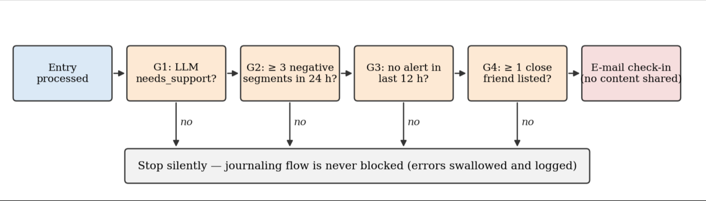
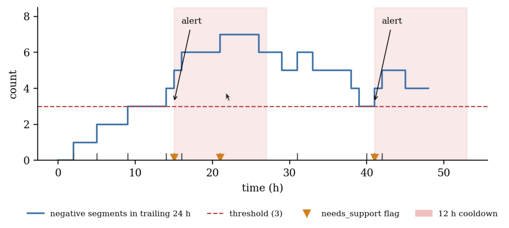
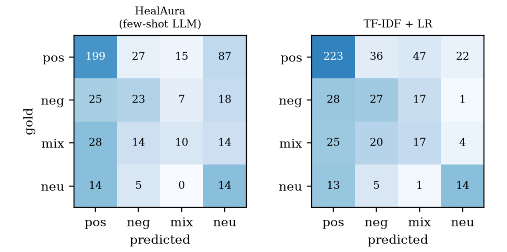
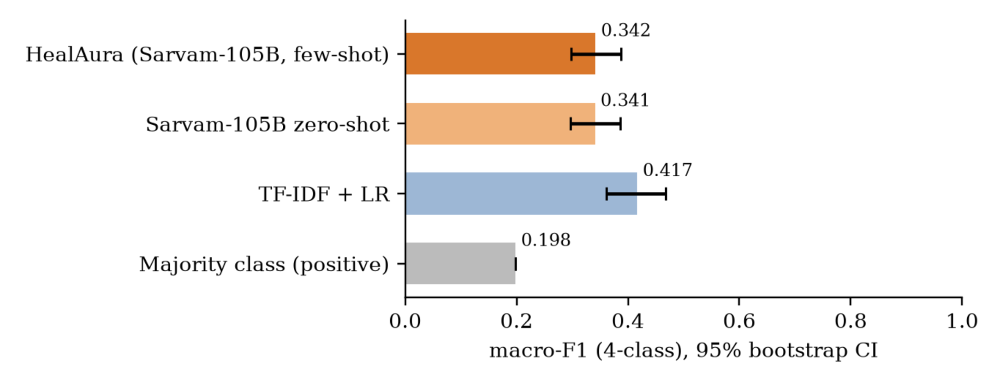

# HealAura: A Listening-First, Code-Mixed Voice Journaling System with Human-in-the-Loop Emotion Labelling and Consent-Based Peer Escalation for Student Stress

**[Author 1 Name]**, *[Department], [Institution], [City], India — [email]*
**[Author 2 Name]**, *[Department], [Institution], [City], India — [email]*
**[Author 3 Name]**, *[Department], [Institution], [City], India — [email]*

---

***Abstract*—Stress and anxiety among higher-education students are common, but machine-learning work on the problem has mostly *predicted* stress from questionnaires and survey features rather than supporting students day to day. Conversational tools that do support them tend to rely on general-purpose chatbots, which give long, advice-heavy replies, handle regional code-mixed language poorly, and escalate to other people in ways that are hard to see. This paper presents *HealAura*, a daily-reflection system built around four design choices. First, students write or speak a short entry in English, Tamil, Hindi, or code-mixed Tanglish/Hinglish; a code-mix-aware speech-to-text model transcribes speech, and a large language model (LLM) splits the entry into clause-level segments, each labelled with a type (*memory*, *event*, *task*), a four-way sentiment (*positive*, *negative*, *neutral*, *mixed*), and extracted date, time, and person. Second, the system replies as a *back-channel listener* of at most six words in the user's own language and register instead of as a default advice-giving chatbot; advice is given only when the user asks. Third, extending the multi-class adaptive active-learning framing of Almadhor *et al.* [7], every model label can be corrected by the user with a single edit, and corrected labels override model labels in all downstream logic, which turns the student into the labelling oracle. Fourth, a gated *well-being agent* combines the LLM's per-entry support signal with a 24-hour sustained-negativity window, a 12-hour cooldown, and an explicit opt-in list of close friends, and sends those friends a content-free check-in e-mail. We describe the architecture, algorithms, and implementation (FastAPI, React, PostgreSQL, Sarvam AI). On 500 Tanglish comments from DravidianCodeMix, the untuned classifier reaches 0.342 four-class macro-F1 (accuracy 0.492) with no in-domain training, against 0.417 for a supervised TF-IDF baseline. Error analysis shows that most of this gap comes from a deliberate rule, sentiment only from evaluative language, meeting a fan-comment labelling convention. Across 1,000 requests the pipeline never fell back, and the well-being agent passes all 26 specification checks. A protocol for the remaining user-study measurements is given.*

***Index Terms*—Code-mixed NLP, Tanglish, Hinglish, sentiment analysis, emotion classification, student stress, active learning, human-in-the-loop, speech-to-text, large language models, mental-health informatics, digital journaling.**

---

## I. Introduction

University students face academic load, placement pressure, financial worry, and social change, often all at once. Systematic reviews show that machine learning (ML) can detect stress among higher-education students [4], and several recent studies predict stress levels from survey and lifestyle features with high accuracy [5], [6]. Almadhor *et al.* [7] went further. They framed student anxiety prediction as a *multi-class* problem and used *adaptive active learning* to reduce how many expert labels were needed, reaching strong accuracy with far fewer annotations.

These systems share a limitation: they end at a prediction. A risk score does not help a student who is struggling at 11 p.m., and questionnaire-based models see a student only when a survey is given. There is also a gap between the language these models are trained on and the language students actually use. In India, everyday speech and chat are heavily *code-mixed*: Tamil–English (Tanglish), Hindi–English (Hinglish), and Punjabi–English all appear in one sentence, often written in Roman script. Recent work shows that code-mixed emotion and sentiment classification needs dedicated modelling [1]–[3].

At the other end of the spectrum, LLM chatbots are now being used in mental-health settings [10]. Used as they come, however, they have two problems in a journaling context. They *talk too much*: long, reassuring, advice-heavy replies turn a private reflection into a counselling session the user did not ask for. They are also *opaque about escalation*: when and to whom a system reaches out is often unclear.

This paper describes **HealAura**, a system that closes the gap between detection and support while keeping the student in control. Its contributions are:

1. **Code-mixed, clause-level structuring of journal entries.** A prompt-engineered LLM pipeline splits each text or voice entry into segments and labels each one with a type, a four-class sentiment, and extracted entities (date, time, person). It handles Tanglish/Hinglish directly, without translating first (Section III-B).
2. **A listening-first response policy.** A *back-channel* generator replies in at most six words, matches the user's language, and never gives unrequested advice. The same model call returns a binary `needs_support` signal (Section III-C).
3. **User-as-oracle label correction.** Building on the active-learning framing of [7], users can fix any segment's type or sentiment with one edit, and every downstream decision uses the corrected label (Section III-E).
4. **A gated, consent-based peer escalation agent.** Four conjunctive gates (LLM signal, sustained negativity, cooldown, opt-in friends) decide whether trusted friends get a content-free check-in (Section III-F).
5. **An open, deployable reference implementation with an empirical evaluation**: a code-mixed sentiment benchmark against supervised baselines, a prompt ablation, reliability measurements, and verification of the agent's logic, plus a protocol for the user study (Sections IV–V).

HealAura is a reflection aid. It is not a diagnostic or therapeutic device. This framing shapes several design decisions discussed in Section VI.

## II. Related Work

### A. Code-Mixed Sentiment and Emotion Classification

Khare and Khan [1] classify emotion in code-mixed Hinglish text with a hybrid network that combines multilingual BERT (mBERT) [11] and attention mechanisms. They show that multilingual contextual encoders beat monolingual baselines on romanised mixed text. Tiwari *et al.* [2] study sentiment in English–Punjabi social-media posts and point out that script variation and language identification cause errors. Jadon *et al.* [3] compare deep-learning models for Hinglish sentiment and highlight nuanced and mixed-polarity statements as a persistent difficulty. Benchmarks such as GLUECoS [12] and DravidianCodeMix [13] confirm that code-mixed performance lags behind monolingual performance, especially for Dravidian languages such as Tamil.

HealAura differs from this line of work in three ways. It (i) labels *clauses* rather than whole posts, because one journal entry often mixes a happy memory with a stressful deadline. It (ii) keeps an explicit *mixed* class, as motivated by [3]. It (iii) uses an instruction-following LLM with few-shot Tanglish examples instead of a fine-tuned encoder, trading some accuracy for zero-shot coverage of low-resource language pairs.

### B. Student Stress and Anxiety Prediction

Macías Arias *et al.* [4] review ML approaches to stress detection in higher education. They find that most studies use questionnaire, physiological, or academic-record features, and that longitudinal, in-the-wild data is rare. Ali *et al.* [5] and Rahunathan *et al.* [6] build classifiers (e.g., random forests and gradient boosting) that predict student stress level from survey attributes. Almadhor *et al.* [7], our base paper, cast anxiety prediction as a multi-class task and use *adaptive active learning*: the model repeatedly selects the most informative unlabelled samples for an oracle to label, which lowers annotation cost [14].

HealAura keeps the central idea of [7], which is to spend human labelling effort where it adds the most value. It changes two things. The data source is the student's own daily language instead of a questionnaire. The oracle is the student, correcting labels in place, instead of an external expert (Section III-E).

### C. Speech and Multimodal Emotion Recognition

Thakur *et al.* [8] compare classical ML and deep-learning models for speech emotion recognition (SER) using acoustic features. Tomar *et al.* [9] fuse facial and speech cues and show that multimodal fusion improves emotion recognition over single-modality models. HealAura currently uses speech as an *input channel* (speech-to-text followed by text emotion analysis) and as an *output channel* (text-to-speech replies). Adding acoustic emotion features in the style of [8], [9] is future work (Section VI-C).

### D. LLM Chatbots in Mental Health

Reategui-Rivera *et al.* [10] build an LLM-based chatbot to reduce mental-illness stigma among healthcare providers. Their work shows both the persuasive power of LLM dialogue and the need for tight scoping of what the model says. The broader history of "therapist" chatbots, going back to ELIZA [15], shows how readily users attribute understanding to conversational agents. HealAura therefore deliberately does *not* ship a default chatbot. The model's reply is limited to a short acknowledgement, and advice exists only as a separate, user-initiated action. This follows the view that expressive writing is beneficial in its own right [16], and that the system's job is to listen, not to steer.

**TABLE I. Positioning of HealAura Against Related Work**

| Work | Input modality | Code-mixed | Granularity | Human-in-loop labels | Acts on prediction |
|---|---|---|---|---|---|
| Khare & Khan [1] | Text | Hinglish | Post | No | No |
| Tiwari *et al.* [2] | Text | Punjabi–En | Post | No | No |
| Jadon *et al.* [3] | Text | Hinglish | Post | No | No |
| Ali *et al.* [5], Rahunathan *et al.* [6] | Survey | — | Person | No | No |
| Almadhor *et al.* [7] | Survey | — | Person | Expert oracle (AL) | No |
| Thakur *et al.* [8], Tomar *et al.* [9] | Speech / face | — | Utterance | No | No |
| Reategui-Rivera *et al.* [10] | Text chat | No | Dialogue | No | Conversational |
| **HealAura (this work)** | **Text + speech** | **Tanglish, Hinglish** | **Clause (segment)** | **User oracle** | **Consent-based peer check-in** |

## III. System Design

### A. Architecture Overview

HealAura is a three-tier web application (Fig. 1). A React 19 + TypeScript single-page client provides five areas: *Talk with AI* (the journal), an anonymous *Community* channel, a *Counsellors* directory, *Close friends* management, and an *Admin* console. An asynchronous FastAPI backend handles authentication (bearer tokens), entry processing, speech I/O, a reminder scheduler, and the well-being agent. All state is stored per user in PostgreSQL. Three hosted Sarvam AI models [19] are called over HTTPS: the Sarvam-105B LLM for classification and replies, Saaras v3 for speech-to-text in code-mix mode, and Bulbul v3 for text-to-speech. Outbound SMTP is used *only* by the well-being agent.



*Fig. 1. HealAura system architecture. AI-backed modules are shaded orange; external services are shaded red. The only outbound path to a third party (SMTP) is gated by the well-being agent.*

### B. Clause-Level Segmentation and Classification

Let an entry be a raw string $x$. The classifier $f_\theta$ (an LLM with a fixed system prompt and few-shot examples) maps $x$ to an ordered set of segments

$$
f_\theta(x) = \{ s_1, \dots, s_n \}, \quad s_i = (\tau_i,\; y_i,\; d_i,\; t_i,\; p_i),
$$

where $\tau_i$ is the segment text, $y_i \in \mathcal{Y}_{\text{type}} \times \mathcal{Y}_{\text{sent}}$ is its label pair, and $d_i, t_i, p_i$ are an optional date, time, and person. The label spaces are

$$
\mathcal{Y}_{\text{type}} = \{\textit{memory}, \textit{event}, \textit{task}\}, \qquad
\mathcal{Y}_{\text{sent}} = \{\textit{positive}, \textit{negative}, \textit{neutral}, \textit{mixed}\}.
$$

The prompt encodes three rules found to matter for journaling text:

- **Topic-shift segmentation.** A single sentence may yield several segments if it changes topic (e.g., "X happened, also Y is tomorrow").
- **Evaluative-language sentiment.** Sentiment comes from evaluative words ("was great", *"suvaiaa irundhichu"* — "it was tasty"), not from the topic alone. "I ate biryani" is *neutral*; "it was tasty" makes it *positive*.
- **Type semantics.** A *memory* is past and needs no action. An *event* has a date or time to schedule. A *task* is an intended action with no fixed time.

Few-shot examples in romanised Tamil anchor the output format and the code-mixed behaviour (Table II).

**TABLE II. Few-Shot Specification Examples (Tanglish) Embedded in the Classifier Prompt**

| Input (romanised Tamil–English) | Gloss | type | sentiment | date | person |
|---|---|---|---|---|---|
| *naan inaiki biryani sapten* | "I ate biryani today" | memory | neutral | — | — |
| *naan inaiki biryani sapten, athu suvaiaa irundhichu* | "…, it was tasty" | memory | positive | — | — |
| *nalaiki en GF oda meeting iruku* | "I have a meeting with my GF tomorrow" | event | neutral | tomorrow | GF |
| *ellarum app pathi paratunanga aana enakku incomplete-aa irundhichu, so inum develop pananum* | "Everyone praised the app but it felt incomplete to me, so I need to develop it more" | task | mixed | — | — |

**Robust decoding.** LLM output is untrusted. The parser removes markdown fences, falls back to the outermost `[...]` span if JSON parsing fails, validates every item against the enumerations $\mathcal{Y}_{\text{type}}$ and $\mathcal{Y}_{\text{sent}}$, and *drops* malformed segments without failing the whole entry. Relative dates ("tomorrow", "tmr", "day after") are resolved to ISO dates on the server. The classifier is retried up to three times. If every attempt returns unusable content, the entry is stored as one *memory/neutral* segment with an `is_fallback` flag, so the user's words are never lost (Algorithm 1). *Event* segments that carry a date or time become reminders.

```
Algorithm 1: Robust segment classification
Input : raw entry x
Output: validated segments S, fallback flag b
 1: for attempt ← 1 to 3 do
 2:     c ← LLM(SYSTEM_PROMPT ⊕ FEW_SHOT, x)
 3:     if API error then remember error; continue
 4:     if c is empty then continue
 5:     S ← ∅
 6:     for each item in ParseJSONArray(StripFences(c)) do
 7:         s ← (text, type, sentiment, ResolveDate(date), ResolveTime(time), person)
 8:         if s.type ∈ Y_type and s.sentiment ∈ Y_sent then S ← S ∪ {s}
 9:     if S ≠ ∅ then return (S, false)
10: if any attempt had an API error then raise error
11: return ({(x, memory, neutral)}, true)          ▷ never lose the entry
```

### C. Listening-First Back-Channel Response

In conversation analysis, *back-channels* are the short signals ("mm", "is it?", "then?") a listener gives to show attention without taking the floor. HealAura's reply generator $g_\phi$ is prompted to act as "the sound someone makes when they are listening". It runs concurrently with $f_\theta$ (Fig. 2) and must return

$$
g_\phi(x) = (r, \sigma), \qquad |r| \le 6 \text{ words}, \quad \sigma \in \{0,1\},
$$

under these constraints: acknowledge rather than analyse; no advice, praise, reframing, or emoji; match the user's language and register exactly (a Tanglish entry gets a Tanglish reply); occasionally ask a short natural question; never echo the user's own words back. The flag $\sigma$ (`needs_support`) is set only for sustained distress, hopelessness, self-harm, or an explicit request for help. The prompt states explicitly that "ordinary bad days are NOT this". Replies are capped at 120 characters. On any failure, the system returns a content-free fallback drawn from {"hmm", "mm", "i see", "go on", "okay"}, on the principle that *a wrong guess is worse than a neutral noise*.

Advice is a separate endpoint (`POST /entries/suggest`) that the user must call explicitly. Even there, the reply is limited to three sentences and one small, concrete action, with no diagnosis. If the entry suggests real distress, the model is told to say plainly that talking to someone would help more, and to stop there.



*Fig. 2. Entry processing pipeline. Voice entries are transcribed by a code-mix speech model; classification and back-channel generation run on the same raw entry; the support flag and stored segments feed the well-being agent.*

### D. Code-Mixed Speech Input and Output

Students often find talking easier than typing, especially in a mixed language. Voice entries are uploaded as audio (`POST /entries/audio`) and transcribed by Saaras v3 in `codemix` mode, which returns a transcript and a detected language code. The transcript then goes through the same pipeline as a text entry. The detected language is stored with each message so the spoken reply (Bulbul v3, `POST /entries/speech`) uses the same language, closing a two-way voice loop. This design keeps the emotion model text-based: speech contributes lexical content, and prosodic cues are left for future work [8], [9].

### E. Human-in-the-Loop Label Correction (Extending [7])

Almadhor *et al.* [7] reduce annotation cost with an active-learning loop: train on a labelled pool, score the unlabelled pool by uncertainty, ask an expert oracle for the most informative labels, and repeat (Fig. 3a). HealAura adapts this loop to a personal, streaming setting (Fig. 3b):

- **The model proposes.** Every segment arrives with LLM-assigned labels $\hat{y}_i$.
- **The user is the oracle.** Each segment is shown in the UI, and the user can correct its type or sentiment with one edit (`PATCH /entries/{id}`), which writes `corrected_type` / `corrected_sentiment`. A `user_confirmed` field records explicit confirmations of correct predictions.
- **Corrections dominate.** Every downstream computation uses the effective label

$$
y_i^{\ast} = \begin{cases} y_i^{\text{user}} & \text{if the user corrected segment } i, \\ \hat{y}_i & \text{otherwise,} \end{cases}
$$

implemented in SQL as `COALESCE(corrected_sentiment, sentiment)`. In particular, a segment wrongly labelled *negative* that the user fixes to *neutral* immediately stops counting toward escalation.

Compared with [7], the oracle is the person with the most authority over the meaning of their own words, and labelling is spread across the natural use of the app instead of a separate annotation campaign. The stored pairs $(\tau_i, \hat{y}_i, y_i^{\text{user}})$ build up into a personalised, code-mixed, clause-level corpus. Section VI-C describes how uncertainty-based querying in the style of [7], [14] could decide *which* segments to show for confirmation first; the `ai_confidence` column is reserved for that purpose.



*Fig. 3. (a) Pool-based adaptive active learning as in the base paper [7]; (b) HealAura's in-app correction loop, in which the student acts as the oracle and corrected labels override model labels in all downstream logic.*

### F. Gated, Consent-Based Well-Being Agent

A single bad day should not trigger outreach, and outreach should never expose what a student wrote. After each entry, the agent evaluates four conjunctive gates (Fig. 4):

- **G1 — Model signal:** the back-channel call for this entry returned $\sigma = 1$.
- **G2 — Sustained negativity:** in the trailing window $W = 24$ h, the number of segments with effective sentiment *negative* satisfies $N_W \ge k$, where $k = 3$.
- **G3 — Cooldown:** no alert has been sent for this user in the last $C = 12$ h.
- **G4 — Consent:** the user has listed at least one close friend.

Formally, an alert is sent at time $t$ if and only if

$$
\sigma_t = 1 \;\wedge\; \sum_{i:\, t - W < t_i \le t} \mathbb{1}[y_i^{\ast} = \textit{negative}] \ge k \;\wedge\; t - t_{\text{last}} \ge C \;\wedge\; |F_u| \ge 1 .
$$

When all gates pass, each listed friend gets a short e-mail saying that the user "has been going through a hard time lately" and that a kind check-in may help. The e-mail *explicitly states that nothing the user wrote is being shared*. The agent catches and logs all of its own errors so that the journaling flow never fails because of it, and an alert is recorded only if at least one e-mail was delivered.



*Fig. 4. Well-being agent gating. Horizontal arrows denote "yes". Any failed gate ends evaluation silently.*

Fig. 5 illustrates the rule on a *synthetic* timeline. Negative segments build up during the first day. The first `needs_support` flag after the window crosses the threshold (at 15 h) triggers an alert. A second flag at 21 h is suppressed by the cooldown even though negativity is still high. A later flag at 41 h, after the cooldown has ended, triggers a second alert.



*Fig. 5. The sustained-distress rule on a synthetic input timeline: trailing 24-h count of negative segments (blue), threshold k = 3 (dashed), model support flags (triangles), and 12-h cooldown periods (shaded). The input events are synthetic; replaying them through the real agent code gives exactly the alerts shown (Table VI).*

### G. Complementary Support Channels

HealAura also offers three low-pressure routes to human support. The first is an **anonymous community** channel, where every post gets a random handle and no names are shown. The second is a **counsellor directory** with one-tap call or e-mail. The third is **admin-managed accounts**, which let an institution (e.g., a college wellness cell) provision users. Journal data is scoped per user and is never visible to the community or to friends.

## IV. Implementation

**TABLE III. Implementation Summary**

| Layer | Technology | Notes |
|---|---|---|
| Client | React 19, TypeScript, Vite | Landing → login → app shell; voice capture in browser |
| API | FastAPI, Uvicorn (async), Pydantic | Bearer-token sessions; per-user scoping on every route |
| Storage | PostgreSQL (Neon) via `asyncpg` | Tables: `users`, `sessions`, `entries`, `messages`, `friends`, `community_messages` |
| LLM | Sarvam-105B | Classification (Alg. 1), back-channel ($T = 0.7$, 200 tokens), suggestion ($T = 0.5$, 400 tokens) |
| STT | Saaras v3, `codemix` mode | Returns transcript + language code |
| TTS | Bulbul v3 | Reply spoken in detected language |
| Notifications | SMTP (Gmail app password) | Optional; the agent skips e-mail if SMTP is not configured |
| Scheduling | In-process scheduler | Reminders for event segments with a date/time |

**Key API endpoints.** `POST /entries` (text entry → segments + reply), `POST /entries/audio` (voice entry), `POST /entries/speech` (TTS), `PATCH /entries/{id}` (label correction), `POST /entries/suggest` (explicit advice), `GET /events` (reminders), `GET/POST /friends`, `GET/POST /community`, `GET /counsellors`.

**Entry schema.** Each segment row stores `raw_text`, `segment_text`, `entry_type`, `sentiment`, `event_date`, `event_time`, `person`, `ai_confidence`, `user_confirmed`, `corrected_type`, `corrected_sentiment`, `is_fallback`, and `created_at`. This schema captures the full proposal–correction history needed for the evaluation in Section V and for future model adaptation.

**Failure isolation.** Three components can fail independently without losing the user's entry: the classifier falls back to one neutral memory segment, the back-channel returns a neutral noise, and the agent swallows its own errors.

## V. Experimental Evaluation

HealAura's evaluation has two parts. Part one covers what can be measured offline now: code-mixed sentiment accuracy against public data and supervised baselines, one prompt ablation, operational reliability, and verification of the well-being agent's logic (Sections V-B to V-E). Part two needs a consented deployment with real students and is specified as a protocol (Section V-F). All scripts, raw model outputs, and metric files are in the `research_paper/eval/` directory of the project repository.

### A. Research Questions

- **RQ1 (Segmentation):** How closely do LLM segment boundaries match human segmentation of code-mixed journal entries? *(deployment study)*
- **RQ2 (Classification):** How accurate is HealAura's four-class sentiment labelling on real Tanglish text, compared with supervised baselines? *(measured, V-B)*
- **RQ3 (Speech):** How much do transcription errors on code-mixed speech (word error rate, WER) reduce downstream sentiment accuracy? *(deployment study)*
- **RQ4 (Correction loop):** How often do users correct labels, which classes are corrected most, and does the correction rate fall over time? *(deployment study)*
- **RQ5 (Escalation):** Does the agent implement its specification exactly *(measured, V-E)*, and what are its precision and false-alarm rate against expert-annotated "needs a check-in" windows *(deployment study)*?
- **RQ6 (Experience):** Do students prefer the back-channel policy to a default verbose chatbot reply? *(deployment study)*

### B. Code-Mixed Sentiment Benchmark (RQ2)

**Dataset.** We use the Tamil–English sentiment portion of DravidianCodeMix [13] (Hugging Face `community-datasets/tamilmixsentiment`): YouTube comments written in romanised or mixed-script Tanglish. Its labels map directly onto HealAura's scheme: *Positive → positive*, *Negative → negative*, *Mixed_feelings → mixed*, *unknown_state → neutral*. Comments labelled *not-Tamil* are excluded. After exclusion, the splits contain 10,967 training, 1,231 validation, and 3,049 test comments.

**Sample.** Because every LLM call goes to a paid, rate-limited API, the LLM conditions are evaluated on a random sample of 500 test comments (seed 42), drawn with the test set's natural class distribution (328 positive, 73 negative, 66 mixed, 33 neutral). Every model is scored on these same 500 comments, which makes paired comparisons possible. Supervised baselines are also reported on the full test split.

**Systems.**
1. *HealAura (few-shot):* the production classifier, `classify.classify_entry` (Algorithm 1), called unchanged. It uses Sarvam-105B with the system prompt and Tanglish few-shot examples, temperature 0.1, and reasoning disabled.
2. *Zero-shot ablation:* the same system prompt and decoding pipeline without the few-shot examples.
3. *TF-IDF + LR:* word 1–2-gram and character 2–5-gram TF-IDF features with class-balanced logistic regression; $C$ is chosen on validation macro-F1 ($C = 2$).
4. *Majority class:* always predicts *positive*.

A fine-tuned mBERT [11] baseline is implemented in the released scripts (`run_baselines.py`) but was not completed. On the 8-core CPU available, training ran at about 15 s per batch of 32, roughly 3 h for two epochs, and the run was interrupted. Results for mBERT, and for a Hinglish benchmark, are therefore left for future work.

**From segments to a comment label.** HealAura labels *segments*, but the dataset labels whole comments. We derive one comment label per comment. If no segment is polar, the label is *neutral*. If exactly one distinct polar sentiment appears, the comment gets that sentiment. If several distinct polar sentiments appear, the comment is *mixed*.

**Metrics.** We report accuracy, macro-F1 (the primary metric, because the classes are imbalanced), weighted F1, and per-class F1. Uncertainty is given as 95% bootstrap confidence intervals (2,000 resamples). Model differences are tested with a paired bootstrap on the same items.

**TABLE IV. Four-Class Tanglish Sentiment Results on the 500-Comment Test Sample (DravidianCodeMix [13])**

| System | Acc. | Macro-F1 [95% CI] | Wtd. F1 | F1 pos | F1 neg | F1 mix | F1 neu |
|---|---|---|---|---|---|---|---|
| Majority class | 0.656 | 0.198 | 0.520 | 0.792 | 0.000 | 0.000 | 0.000 |
| TF-IDF + LR (supervised) | 0.562 | **0.417** [0.361, 0.468] | **0.578** | 0.723 | 0.335 | 0.230 | **0.378** |
| Sarvam-105B zero-shot | 0.492 | 0.341 [0.297, 0.387] | 0.522 | 0.663 | **0.350** | 0.194 | 0.156 |
| **HealAura** (Sarvam-105B few-shot) | 0.492 | 0.342 [0.297, 0.387] | 0.525 | 0.670 | 0.324 | 0.204 | 0.169 |

*On the full 3,049-comment test split, TF-IDF + LR scores accuracy 0.583 and macro-F1 0.413.*



*Fig. 6. Confusion matrices (counts) on the 500-comment sample. Rows are gold labels; columns are predictions.*



*Fig. 7. Four-class macro-F1 with 95% bootstrap confidence intervals on the same 500 comments.*

**Findings.**

1. *A supervised in-domain baseline beats the untuned LLM on this dataset.* HealAura's classifier used no training data from this dataset, yet it reaches a macro-F1 of 0.342, well above the majority baseline (0.198). A TF-IDF model trained on 10,967 in-domain comments still does better. The paired bootstrap difference is +0.073 macro-F1 in favour of TF-IDF + LR (95% CI [0.011, 0.139]). A fine-tuned transformer such as mBERT [1], [11] would be expected to widen this gap further; it was not run here (see *Systems*).
2. *The main error is a deliberate design choice meeting a different labelling convention.* The largest confusion cell is gold *positive* predicted as *neutral*: 87 of 328 positive comments (26.5%). Many of these comments express fan anticipation or hype without evaluative words (Table V). The dataset's annotators label such comments *positive*. HealAura's prompt tells the model to base sentiment on evaluative language "NOT on the topic alone" (Section III-B), because in a journal, "I have an exam tomorrow" should not be read as positive or negative. The conflict is therefore mostly a *domain* mismatch (movie-trailer comments versus personal reflections), not a failure to understand Tanglish.
3. *The mixed class remains hard.* Mixed recall is 0.15 for HealAura. Mixed comments are most often predicted *positive* (28 of 66). This matches earlier reports that nuanced, mixed-polarity code-mixed text is the hardest case [3], and even the supervised baseline reaches only 0.230 F1 on it.
4. *Negative detection is on par.* The signal that matters most to HealAura is *negative*, because it feeds gate G2. For this class, HealAura's F1 (0.324) is close to the supervised TF-IDF model's (0.335) and the zero-shot variant's (0.350). Negative precision is 0.33 and recall 0.32. Taken alone, this confirms the design decision not to act on single labels: gate G2 requires at least three negative segments within 24 h *and* an independent model signal, and users can correct any label.

**TABLE V. Representative Errors (Gold *positive*, Predicted *neutral*)**

| Comment (verbatim) | Why the prompt rule yields *neutral* |
|---|---|
| *Yarayellam FDFS ppga ippove ready agitinga* ("Who's already ready to go for the first-day-first-show?") | Plan or anticipation; no evaluative word |
| *Petta paraak thalaivar oda atathuku waiting....* ("Waiting for Thalaivar's performance in Petta") | Anticipation; "waiting" is not evaluative |
| *Today morning trending no.1 la paakkalaam* ("We'll see it trending no. 1 this morning") | Prediction of a fact |
| *best under 7000 rupees mobile* | Off-topic product phrase |

### C. Prompt Ablation: Few-Shot vs. Zero-Shot

Removing the four Tanglish few-shot examples leaves macro-F1 essentially unchanged: 0.341 versus 0.342, with a paired difference of −0.002 (95% CI [−0.041, +0.035]). The two variants give the same comment label for 79.6% of items. The examples mainly change *structure*. Without them, the model splits more comments into several segments (45.2% versus 38.6%) and gives more segments a spurious *event* or *task* type (162 of 777 segments, 20.8%, versus 125 of 748, 16.7%). YouTube comments contain almost no real events or tasks, so the lower rate is the more plausible one. The examples therefore act mainly as format and granularity anchors rather than sentiment teachers. In both conditions, *memory* is the dominant type (83% of few-shot segments).

### D. Operational Reliability

Across 1,000 classification requests (500 per condition), the production pipeline produced **zero** fallback segments: every response parsed into at least one valid segment within the three built-in retries. It also produced **zero** unrecovered API errors. The median end-to-end latency per comment was 2.17 s (95th percentile 4.24 s) for the few-shot pipeline and 2.62 s (4.31 s) for zero-shot. These times were measured from the client and include network time. One operational finding matters for deployment. At six concurrent requests, the Sarvam API returned HTTP 429 (rate limit exceeded) for most calls, and the benchmark had to be rerun at a concurrency of two with exponential backoff. A multi-user deployment therefore needs a request queue or a higher API tier. Since the classifier raises an error on repeated API failures rather than silently falling back (Algorithm 1, line 10), rate limiting shows up to the user as a visible error, not a wrong label.

### E. Well-Being Agent Verification (RQ5, Specification)

We ran the unmodified `agent.evaluate_and_alert` against an in-memory stand-in for its four database calls and the SMTP sender (script `run_agent_checks.py`). The results are:

**TABLE VI. Well-Being Agent Verification**

| Check | Result |
|---|---|
| Full truth table over G1–G4 (16 combinations): alert ⇔ all four gates hold | **16 / 16** correct |
| G2 boundary: 2 negatives → no alert; 3 negatives → alert | Pass |
| G2 window: 3 negatives older than 24 h → no alert | Pass |
| G3 boundary: last alert 11.9 h ago → suppressed; 12.0 h ago → alert | Pass |
| User correction: one of three negatives corrected to *neutral* → no alert | Pass |
| SMTP failure → returns *false*, cooldown not started (retry allowed later) | Pass |
| Database exception → returns *false*, no exception reaches the entry flow | Pass |
| Privacy: alert e-mail contains no entry text (the agent is never given the text) | Pass |
| Replay of the Fig. 5 timeline: alerts at 15 h and 41 h, flag at 21 h suppressed | Pass (matches Fig. 5) |

These checks confirm that the implementation matches its specification (Section III-F), including the property that user corrections feed into escalation. They do *not* measure whether the thresholds are clinically appropriate. That requires the deployment study below.

### F. Deployment Study Protocol (Pending)

The remaining questions need real students and are left for an ethics-approved study.

1. **HealAura-CM corpus.** Consenting student volunteers write or speak daily entries for 2–4 weeks. Two annotators independently label segment boundaries, type, and sentiment, and inter-annotator agreement is reported as Cohen's $\kappa$. This corpus addresses the domain mismatch identified in V-B and allows segmentation to be scored (RQ1: boundary F1, WindowDiff) and *type* accuracy to be scored, since the public data has no type labels.
2. **Speech (RQ3).** Paired spoken and typed versions of the same entries allow WER to be measured for Saaras v3 in `codemix` mode, along with the drop in sentiment macro-F1 from text to transcript.
3. **Correction loop (RQ4).** The rate of `corrected_*` edits per segment, by class and by week.
4. **Escalation (RQ5).** Alert precision and recall, and false alerts per user-month, against clinician-annotated 24-h windows. PSS-10 [17] and GAD-7 [18] are used as reference measures, not as system inputs.
5. **Experience (RQ6).** A within-subject preference test of back-channel replies versus default verbose chatbot replies.

**TABLE VII. Pending Deployment Metrics**

| Metric | Status |
|---|---|
| Segmentation boundary F1 / WindowDiff (RQ1) | Pending user study |
| Type accuracy on journal entries (RQ1/RQ2) | Pending user study |
| STT WER, code-mixed speech; text → transcript F1 drop (RQ3) | Pending user study |
| User correction rate, week 1 → final week (RQ4) | Pending user study |
| Alert precision / recall; false alerts per user-month (RQ5) | Pending user study |
| Preference: back-channel vs. verbose chatbot (RQ6) | Pending user study |

## VI. Discussion

### A. Ethics, Privacy, and Safety

- **Not a clinical device.** HealAura does not diagnose and does not replace professional care. The counsellor directory and community exist to direct students toward humans.
- **Content minimisation in escalation.** Friend alerts carry no journal content, sentiment scores, or timestamps, only a nudge to check in.
- **Consent and control.** Escalation happens only to friends the user added personally. Users can remove friends at any time, and corrections let users overrule the model's reading of their words.
- **Crisis limitations.** The agent's cooldown and thresholds are tuned to avoid false alarms, not for crisis response. A deployment must display local emergency and helpline numbers and should route explicit self-harm disclosures to an immediate, visible safety message rather than wait for the gate thresholds.
- **Data protection.** The current prototype stores entries in standard PostgreSQL and sends text to a third-party model API. A production deployment needs encryption at rest, data-processing agreements, retention limits, and review by an institutional ethics committee.

### B. Limitations

The system depends on a hosted LLM whose behaviour can change between versions, so prompts need regression tests. Thresholds ($k = 3$, $W = 24$ h, $C = 12$ h) are heuristic and not yet validated against clinical outcomes. Counting negative *segments* instead of entries may give extra weight to users who write long, detailed entries. Speech input discards prosody, which carries emotional information [8], [9]. The sentiment benchmark (Section V-B) uses YouTube comments, not journal entries; its labelling conventions differ from HealAura's evaluative-language rule, so it underestimates in-domain accuracy in some respects and cannot measure type or segmentation accuracy at all. It also covers only Tanglish; Hinglish has not yet been benchmarked. Finally, the counsellor directory currently holds demonstration data.

### C. Future Work

1. **Uncertainty-driven confirmation.** Following [7], [14], fill `ai_confidence` (e.g., from self-consistency over several samples) and ask users to confirm only the most uncertain segments. This turns passive correction into true active learning.
2. **Personal adaptation.** Use accumulated $(\tau, \hat{y}, y^{\text{user}})$ triples as per-user few-shot examples or to fine-tune a small on-device classifier.
3. **Multimodal affect.** Fuse acoustic SER features [8] with text sentiment, following the multimodal fusion results of [9].
4. **Hybrid classification.** The benchmark in Section V-B suggests combining a small supervised code-mixed model (cheap, fast, and strong on in-domain conventions) with the LLM (segmentation, entity extraction, and the evaluative-language rule), for example by using the LLM only when the supervised model is uncertain.
5. **Stronger baselines.** Complete the GPU-trained mBERT/XLM-R baselines and add a Hinglish benchmark, so that results can be compared directly with [1]–[3].
6. **Trend modelling.** Replace the fixed-window count with a longitudinal model of emotional trajectory (e.g., an exponentially weighted negativity score), validated against PSS-10/GAD-7 changes [17], [18].

## VII. Conclusion

HealAura moves student-stress research from prediction toward support that respects the student's language and autonomy. It structures code-mixed text and voice journal entries at the clause level, answers with a brief listening response instead of unrequested advice, lets students correct the model's reading of their words, and reaches trusted friends only through a transparent, multi-gate, content-free check-in. Following the adaptive active-learning perspective of our base paper [7], it treats human labels as the scarcest and most valuable signal, and it obtains them from the one person best placed to give them. Our offline evaluation shows that the untuned code-mixed classifier is reliable in operation but trails a supervised in-domain baseline on public Tanglish data, largely because of a deliberate, journaling-specific sentiment rule. This result points to the correction loop and the planned HealAura-CM corpus as the right next steps. The accompanying protocol defines how to measure segmentation, speech robustness, and escalation safety in a real student deployment.

## Acknowledgment

The authors thank [institution / wellness cell / volunteers]. Speech and language models were accessed through the Sarvam AI platform.

## References

[1] B. K. Khare and I. Khan, "Optimized emotion classification in code-mixed Hinglish text using an mBERT based hybrid neural network with attention mechanisms," *Int. J. Inf. Technol.*, Nov. 2025, doi: 10.1007/s41870-025-02813-5.

[2] A. Tiwari, J. Sehgal, M. Singh, and A. Mishra, "Sentiment analysis in English-Punjabi mixed social media posts," in *Proc. IEEE Int. Conf. Interdisciplinary Approaches Technol. Manage. Social Innov. (IATMSI)*, 2025, pp. 1–6, doi: 10.1109/IATMSI64286.2025.10985051.

[3] A. S. Jadon, M. Parmar, and R. Agrawal, "Hinglish sentiment analysis: Deep learning models for nuanced sentiment classification in multilingual digital communication," in *Proc. 2nd Int. Conf. Device Intell., Comput. Commun. Technol. (DICCT)*, 2024, pp. 318–323, doi: 10.1109/DICCT61038.2024.10533057.

[4] E. Macías Arias, J. Parraga-Alava, and D. Zambrano Montenegro, "Stress detection among higher education students: A comprehensive systematic review of machine learning approaches," in *Proc. 10th Int. Conf. eDemocracy eGovernment (ICEDEG)*, 2024, pp. 1–8, doi: 10.1109/ICEDEG61611.2024.10702055.

[5] H. Ali, M. H. Amin, A. U. Rehman, S. Javaid, T. M. Ali, and A. Mir, "Predictive modeling of students' stress levels using machine learning algorithm," in *Proc. Int. Conf. Emerg. Trends Netw. Comput. Commun. (ETNCC)*, 2024, pp. 417–423, doi: 10.1109/ETNCC63262.2024.10767502.

[6] L. Rahunathan, S. Nafais A, A. G, R. P, S. L. S, and S. V. N, "Machine learning model for student stress level prediction," in *Proc. 4th OPJU Int. Technol. Conf. (OTCON)*, 2025, pp. 1–7, doi: 10.1109/OTCON65728.2025.11070804.

[7] A. Almadhor, S. Abbas, G. A. Sampedro, S. Alsubai, S. Ojo, A. Al Hejaili, and L. Strazovska, "Multi-class adaptive active learning for predicting student anxiety," *IEEE Access*, vol. 12, pp. 58097–58105, 2024, doi: 10.1109/ACCESS.2024.3391418.

[8] A. K. Thakur, S. K. Bisoy, P. Mishra, R. P. Patra, and R. Ranjan, "Speech emotion recognition using machine learning and deep learning," in *Proc. 1st Int. Conf. Cognitive, Green Ubiquitous Comput. (IC-CGU)*, 2024, pp. 1–6, doi: 10.1109/IC-CGU58078.2024.10530666.

[9] P. S. Tomar, K. Mathur, and U. Suman, "Fusing facial and speech cues for enhanced multimodal emotion recognition," *Int. J. Inf. Technol.*, vol. 16, no. 3, pp. 1397–1405, 2024, doi: 10.1007/s41870-023-01697-7.

[10] C. M. Reategui-Rivera, A. Smiley, and J. Finkelstein, "LLM-based chatbot to reduce mental illness stigma in healthcare providers," in *Proc. IEEE 15th Annu. Comput. Commun. Workshop Conf. (CCWC)*, 2025, pp. 1–7, doi: 10.1109/CCWC62904.2025.10903778.

[11] J. Devlin, M.-W. Chang, K. Lee, and K. Toutanova, "BERT: Pre-training of deep bidirectional transformers for language understanding," in *Proc. NAACL-HLT*, 2019, pp. 4171–4186.

[12] S. Khanuja, S. Dandapat, A. Srinivasan, S. Sitaram, and M. Choudhury, "GLUECoS: An evaluation benchmark for code-switched NLP," in *Proc. 58th Annu. Meeting Assoc. Comput. Linguistics (ACL)*, 2020, pp. 3575–3585.

[13] B. R. Chakravarthi *et al.*, "DravidianCodeMix: Sentiment analysis and offensive language identification dataset for Dravidian languages in code-mixed text," *Lang. Resour. Eval.*, vol. 56, pp. 765–806, 2022.

[14] B. Settles, "Active learning literature survey," Univ. Wisconsin–Madison, Madison, WI, USA, Comput. Sci. Tech. Rep. 1648, 2009.

[15] J. Weizenbaum, "ELIZA—A computer program for the study of natural language communication between man and machine," *Commun. ACM*, vol. 9, no. 1, pp. 36–45, 1966.

[16] J. W. Pennebaker, "Writing about emotional experiences as a therapeutic process," *Psychol. Sci.*, vol. 8, no. 3, pp. 162–166, 1997.

[17] S. Cohen, T. Kamarck, and R. Mermelstein, "A global measure of perceived stress," *J. Health Soc. Behav.*, vol. 24, no. 4, pp. 385–396, 1983.

[18] R. L. Spitzer, K. Kroenke, J. B. W. Williams, and B. Löwe, "A brief measure for assessing generalized anxiety disorder: The GAD-7," *Arch. Intern. Med.*, vol. 166, no. 10, pp. 1092–1097, 2006.

[19] Sarvam AI, "Sarvam AI platform documentation: Chat completions, speech-to-text (Saaras), and text-to-speech (Bulbul)." [Online]. Available: https://docs.sarvam.ai
